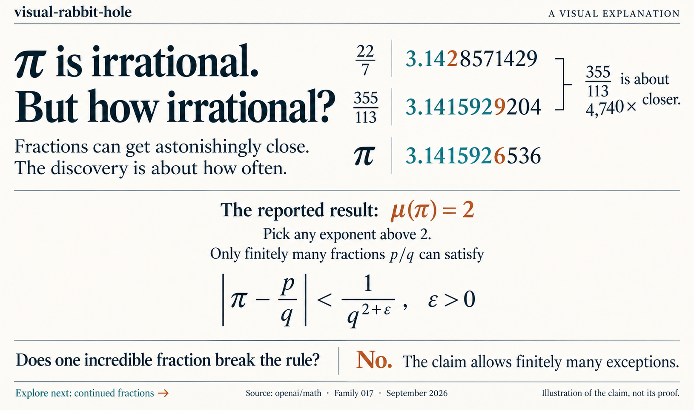

# visual-rabbit-hole

**Come for an explanation. Leave with a better question.**

An agent skill for curious people. Get the insight in chat, then explore an interactive page with diagrams you can step through, questions you can try, and side quests worth following.



*An illustrative lesson preview based on [OpenAI's September 2026 preprint](https://github.com/openai/math/blob/main/preprints/The-irrationality-exponent-of-pi-is-2-September-24-2026/paper.pdf). OpenAI reports μ(π) = 2 and [lists a Lean formalization](https://github.com/openai/math/blob/main/lean/docs/017.md); this graphic explains the claim, not its proof.*

<details>
<summary>Read the example in text</summary>

**π is irrational. But how irrational?** Fractions can get astonishingly close. The discovery is about how often.

| Fraction | Decimal approximation | Absolute error from π |
| --- | --- | --- |
| 22/7 | 3.1428571429 | ≈ 0.0012644893 |
| 355/113 | 3.1415929204 | ≈ 0.0000002668 |

The second fraction is about **4,740 times closer**. For comparison, π ≈ 3.1415926536.

The reported result, μ(π) = 2, means that for every fixed ε > 0, only finitely many fractions p/q, with integer p and positive integer q, satisfy `|π − p/q| < 1/q^(2+ε)`. One unusually accurate fraction does not contradict it: the claim allows finitely many exceptions. The picture illustrates this distinction; it does not establish the theorem.

**Next rabbit hole:** How do continued fractions find such good approximations?

</details>

## a taste

You make one machine twice as fast. The factory produces exactly as much.

Why?

Imagine three machines in a line, with plenty of material to process. These are their maximum rates:

```text
       CUT             PAINT            PACK
   [12/hour] ──────→ [3/hour] ──────→ [12/hour]

                  Output: 3/hour
```

Double the cutting speed:

```text
       CUT             PAINT            PACK
   [24/hour] ──────→ [3/hour] ──────→ [12/hour]
                       ↑
              still setting the pace

                  Output: 3/hour
```

More cutting capacity. Painting still finishes only three items an hour.

You've just met a **bottleneck**. In this simplified line, the slowest stage sets the maximum steady output. Speeding up another stage can leave more unfinished work waiting for paint.

Now there's somewhere to go:

- **Go deeper:** What happens after you upgrade the painting machine?
- **Go sideways:** Where is the painting machine in your own workday?
- **Break the model:** What if the machines keep stopping and starting?

Pick a thread. Keep the picture. See what changes.

## take it for a spin

The chat gives you that first insight. The page lets you work with it:

- **Change the picture.** Step through an upgrade and watch the bottleneck move.
- **Try a new case.** Quiz answers explain the reasoning. Wrong answers stay retryable.
- **Follow a side quest.** Go deeper, connect to another field, or test where the model breaks. Each quest has its own lesson, diagram, and questions.
- **Keep going.** Copy a quest's continuation prompt into chat for the next page, building on the model you've explored.

Explore quests in any order. A tracker shows which ones you've cleared, with progress saved in that browser when storage is available.

## install

```bash
npx skills add alberthammerich/visual-rabbit-hole
```

Choose your agent in the installer. Supports Claude Code, Codex, Cursor, OpenCode, and [other compatible agents](https://github.com/vercel-labs/skills#supported-agents).

## follow your curiosity

Ask your agent to use visual-rabbit-hole:

> Use visual-rabbit-hole to teach me recursion.

> Help me understand entropy with visual-rabbit-hole.

> Use visual-rabbit-hole to explore why cities grow where they do.

Then follow what interests you:

> Show me what happens if we change that assumption.

> Where does this analogy stop working?

> Take me down the second rabbit hole.

Explanations build on the conversation: the useful diagram stays, the model grows, and each branch starts from what you've already explored. For a quick clarification, ask directly. For a more interactive session, ask to predict what happens before the reveal.

Want just the short version? Say **"quick"** or **"no page."** Follow-ups stay in chat unless you choose another quest or ask to update the page.

Pages open through your agent's artifact or HTML preview when available. Otherwise, you get a standalone HTML file in the configured output directory, or `./rabbit-holes/YYYY-MM-DD-<slug>.html`.

## the idea

Intuition first. Give the question a reason to matter, then make the mechanism visible. Use an analogy while it helps, and show where it breaks. Follow connections that share something specific: a constraint, a feedback loop, a pattern.

Text diagrams work right in chat; HTML and SVG bring the page to life. Sources ground explanations when facts need checking.

Science, code, history, philosophy—start wherever you're curious.

See a [three-turn exploration](references/example-explanations.md) or read the [skill instructions](SKILL.md).

## contributing

Bring a question that deserves a better explanation.

For changes to the skill, include a short before-and-after conversation showing what improves. A clearer diagram, a stronger question, or a more honest analogy is a good place to start.
